# MultiRate.jl

Partially implicit multirate infinitesimal step (MIS) methods for the compressible Euler equations
with gravity in 2D (x–z), tested on several spatial discretizations.

The project studies one question: **which parts of the fast linear operator should be treated
implicitly, and where?** The time integrator is the same for all discretizations. The spatial
discretizations supply a fast operator and a choice of its implicit part.

## The method class

The semi-discrete system is written as `q' = N(q)`. At the start of a large step the fast linear
operator `L = L(qⁿ)` is frozen, and the right-hand side is split by adding and subtracting it:

```text
q' = L q + (N(q) − L q) = L q + S(q),       L = L_E + L_I
```

- The **slow part** `S(q)` is advanced by the outer MIS tableau (MIS4 by default) with the large
  step Δt, which is limited by advection in the free atmosphere.
- In each MIS stage the **fast part** is integrated with small steps Δτ, with `L_E` treated explicitly
  and `L_I` implicitly. The stage tendency `S` is held constant.

Tableaus (`mis_tableau`): WSRK3, MIS2, MIS3C, MIS4, MIS4a (Knoth & Wensch 2014), MIS_KW3
(Knoth–Wolke RK3 in MIS form) and MIS54 (Bauer & Knoth 2021). `mis_observed_order` measures the
order with exact fast stages on a problem where `L` and `S` do not commute, so it includes the MIS
coupling conditions:

| | WSRK3 | MIS2 | MIS3C | MIS4 | MIS4a | MIS_KW3 | MIS54 |
|---|---|---|---|---|---|---|---|
| RK order (L = 0) | 2 | 2 | 3 | 3 | 3 | 3 | 4 |
| MIS order | 2 | 2 | **2** | 3 | 3 | 3 | 4 |
| fast time Σ dᵢ / Δt | 1.83 | 1.19 | 1.19 | 1.44 | 1.47 | 1.00 | 1.88 |

MIS3C (coefficients as in ClimaTimeSteppers.jl) is only second order once `L ≠ 0`, which still has
to be checked against the paper.

**Lawson RK** (`:LRK4`, `:LRK3`, `:LRK2`) and **ETD in stage-ODE form** (`:EB1`, `:ETD2`, `:EB4`
Krogstad, after the MATLAB `SplitExplicitETD.m`: each stage a fast ODE with a slow forcing that is a
polynomial in the local time) use the same fast loops as MIS; select them like the MIS tableaus
(`TABLE=LRK4` in the drivers). **High-order fast loops:** `:<base>_s4` (Suzuki, order 4), `_y4`,
`_y6` (Yoshida) compose `:verlet`, FV `:hevi` or `:hevi_verlet`.

At large slow steps (FV gravity wave, [docs/FINDINGS.md](docs/FINDINGS.md) §9): for the wave MIS54
with the plain `hevi` loop is as accurate as LRK4/EB4 with the fourth-order `hevi_s4` and stays
stable up to UΔt/Δx = 1.6; Lawson/ETD keep the fast acoustic modes (exact for S = 0), MIS damps
them. For MIS the best number of substeps is the smallest stable one; Lawson/ETD need `_s4` at
that number.

**EPIRK-W** (`:EPIRKW3a`, `:EPIRKW3b`, Tokman et al.), the classical **EPIRK4** and **exponential
Adams–Bashforth** (`:EAB2`…`:EAB4`, the multistep EPI form) run in the same stage-ODE form with the
MIS fast loops. They are correct (orders 3, 3, 4 with the Jacobian, 2–4) but stable only where the
acoustics are almost resolved (cΔt/Δx ≲ 0.5 on the gravity wave), see [FINDINGS](docs/FINDINGS.md) §10.

**Frozen part of the right-hand side** (`TimeStepping.run_frozen`, flat FV): instead of adding and
subtracting a linearized fast operator, N(q) = F(q, q) with the slow part (momentum advection) and
the face θ frozen at the stage values and the nonlinear acoustic-gravity part evolving in the fast
loop (`:verlet` or `:hevi`). On the gravity wave it stays stable and accurate up to UΔt/Δx = 1.6
where the linearized split degrades; with a non-additive F the MIS4/MIS54 orders drop to 2
(mixed B-series trees), [FINDINGS](docs/FINDINGS.md) §11.

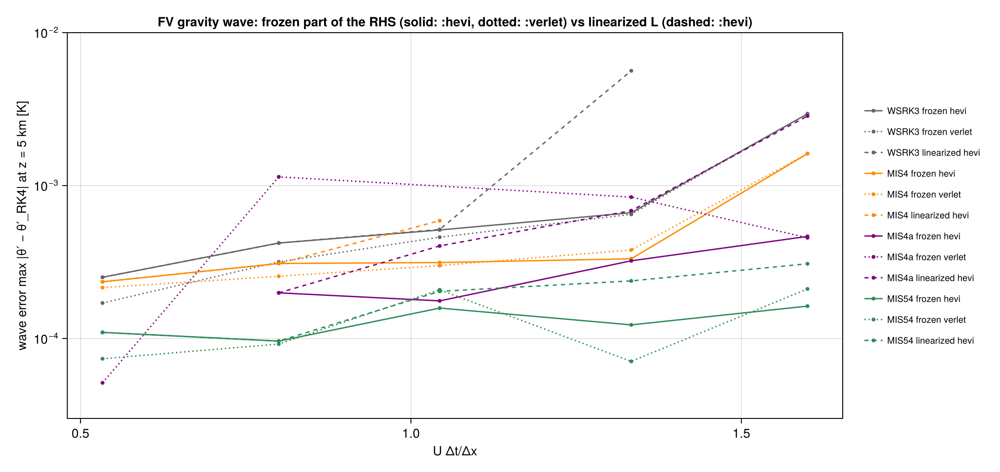

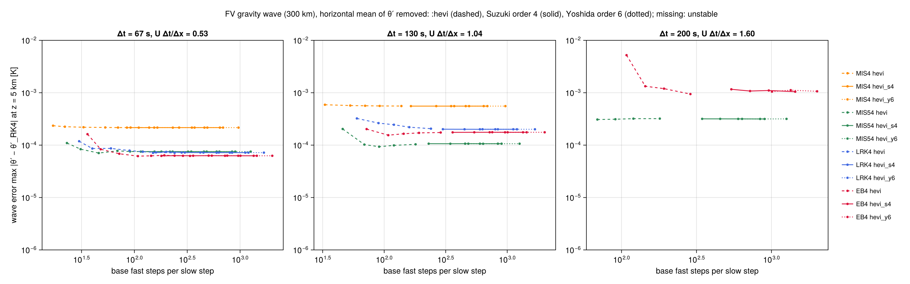

`L` and its split `L_I` can be chosen locally. That choice is the subject of the project:

| Splitting | Typical choice of `L_I` | Removes the step limit from |
|---|---|---|
| vertical vs horizontal (HEVI) | vertical acoustics and buoyancy in every column | small Δz |
| acoustics vs advection | advection in `L` only where it is needed, otherwise acoustics only | — (advection stays explicit, Δt ∝ Δx/U) |
| cut cells | acoustics **and** advection in a mask around the cut cells | arbitrarily small cut cells |

The order of the method does not depend on what is used for `L` (W-method property). Stability
does. In cut cells the implicit advection can be a simplified Jacobian, for example first-order
upwind, while the right-hand side keeps the conservative third-order scheme. Outside the mask
`L` is purely acoustic, so the explicit-advection limit of the underlying split-explicit method
still applies there (Jebens, Knoth & Weiner 2011). Because the implicit region covers only a thin
layer near the ground, a cut-cell grid costs about as much as the split-explicit method on a
regular grid.

## Spatial discretizations and fast solvers

| Discretization | Terrain | Fast solvers (`fast=`) |
|---|---|---|
| DGSEM, split form (`src/DGSEM/Euler2D`) | terrain-following (Gal–Chen) | `hevi`, `hevi_relax`, `verlet`, `fb`, `imex` |
| FV, Arakawa C-grid (`src/FV`) | terrain-following | `hevi`, `wrf`, `verlet`, `fb` |
| FV, Arakawa C-grid with cut cells (`src/FV/cutcell_*`) | Cartesian cells cut by `zs(x)` | `hevi`, `rosenbrock_amf`, `verlet`, `fb` |

- **`hevi`:** horizontal fast terms explicit, vertical column solve implicit. On cut-cell grids
  this solver is still limited by the smallest cut cell.
- **`rosenbrock_amf`** (cut cells only): a three-stage Rosenbrock-W fast integrator with approximate
  matrix factors.
  - Implicit: vertical acoustics everywhere, plus horizontal acoustics and first-order masked
    advection in the cut-cell mask.
  - Explicit: horizontal acoustics outside the mask.
  - Its step limit therefore comes from the regular-grid horizontal acoustic CFL and is independent
    of the cut-cell size.
- **Cut-cell masks:** the mask is a heuristic (`CutCellFVGrid(...; mask=:diag)`, as in the MATLAB
  reference; variants `:cut`, `:cut4`, `:cut8`, `:all`).
- **Cut-cell advection:** the right-hand side uses the third-order `AdvectionCutThird` scheme by
  default (`advection=:third`); the first-order alternative is `advection=:upwind1`.
  Open problem: a warm layer of ≈ 0.35 K in the lowest cells downstream of the hill (a10).
  `CUT_THETA_RECON` selects the Θ face value where the upstream neighbour is missing: `:donor`
  (MATLAB, default), `:onesided` (keeps the downstream term, second order; changes little), or
  `:perturbation` (reconstructs θ' = θ − θ̄(z), ≈ 0.16 K; uses a background state).

## Code layout

```text
src/TimeStepping   MIS tableaus and stages, slow residual S = N − L(qⁿ), generic fast loops,
                   order analysis of the tableaus
src/LinearAnalysis amplification matrices of MIS steps for linear test problems (Fourier modes)
src/DGSEM          split-form DGSEM state, geometry, RHS, fast operator, column solver
src/FV             C-grid FV: terrain-following grid and fast operators; cut-cell geometry,
                   RHS, HEVI column solve and Rosenbrock-W/AMF fast solver
src/Common         gas law, reference states, output (VTKHDF, plots via extensions)
examples/          case drivers; examples/intro_2d holds the short introductory cases,
                   examples/linear_analysis the linear stability study
```

A spatial discretization provides `rhs_nonlinear!`, `fast_operator` (freeze `L` at `qⁿ`) and the
pieces its fast solver needs (`fast_apply!`, column factors, model-specific integrators). The MIS
layer is independent of the mesh and the equations.

## Install and run

Run the commands from the repository root. Install the example environment once:

```sh
julia --project=examples -e 'using Pkg; Pkg.instantiate()'
```

### Introductory cases

These cover the warm bubble and the Agnesi hills (a = 1, 10, 100 km, h = 400 m, U = 10 m/s,
N = 0.01 s⁻¹) on all three discretizations:

```sh
julia --project=examples examples/intro_2d/warm_bubble.jl   dg|fv|fvc [T|-] [fast]
julia --project=examples examples/intro_2d/agnesi_hills.jl  a1|a10|a100 [T|-] [fast] [dg|fv|fvc]

# cut cells, horizontally explicit acoustics (step limited by the smallest cut cell)
julia --project=examples examples/intro_2d/agnesi_hills.jl a10 - hevi fvc
# cut cells, partially implicit fast solver (step independent of the cut-cell size)
julia --project=examples examples/intro_2d/agnesi_hills.jl a10 - rosenbrock_amf fvc
```

`examples/intro_2d/README.md` describes the options, and `check_bubble.jl` and `check_agnesi.jl`
are quick consistency checks. Environment controls include `NEX`, `NEZ`, `P`, `LX`, `LFACTOR`,
`H0`, `ZD`, `NSUB`, `U0` (hill inflow speed; `U0=0` is a resting atmosphere), `CUT_H0` and `CUT_A`. FV grids use `P*NEX × P*NEZ` cells.

### Production drivers

```sh
julia --project=examples examples/euler2d_bubble.jl        dg|fv [T|-] [fast]
julia --project=examples examples/euler2d_gravity_wave.jl  dg|fv [fast]        # env NSUB
julia --project=examples examples/euler2d_gravity_wave_long.jl dg|fv [fast]   # env NSUB
julia --project=examples examples/euler2d_hills.jl         a1|a10|a100 [T|-] [fast]   # DGSEM
```

Results are written to the current directory as VTKHDF time series and PNG plots. Generated output
files are ignored by git.

### Linear analysis of the MIS methods

```sh
julia --project=examples examples/linear_analysis/mis_stability.jl
julia --project=examples examples/linear_analysis/fv_gravity_wave_split.jl   # linearized FV, a few minutes
```

`MultiRate.LinearAnalysis` (after the MISDG experiments) treats a linear problem q′ = N q with fast
part L as a model of the TimeStepping interface. `step_matrix` runs the production `mis_step!` and
fast loops (`:verlet`, `:fb`, `:wrf`, `:hevi`, …) on unit vectors, or uses exact fast stages
(`fast = :exact`). A Fourier mode with complex symbols becomes a real model of twice the size.
The test problems are the Knoth–Wensch linear acoustics test (C-grid, 3rd-order upwind
advection) and the MISDG grid (4th-order staggered acoustics, 5th-order upwind advection) with a
1D pressure pulse and its exact semi-discrete solution. `linearized_mode_model` does the same for the
production models: per horizontal Fourier mode it builds the column blocks of the Jacobian of
`rhs_nonlinear!` and of the frozen fast operator (flat grids). `boussinesq_symbols` is a
constant-coefficient acoustic-gravity model on the FV grids. All results are collected in
[docs/FINDINGS.md](docs/FINDINGS.md). The MISDG talk on acoustics with advection and multirate
methods (LaTeX sources, data, PDF) is in [docs/talks/](docs/talks/README.md). A LaTeX report of all
findings with the figures: [docs/findings/findings.pdf](docs/findings/findings.pdf).

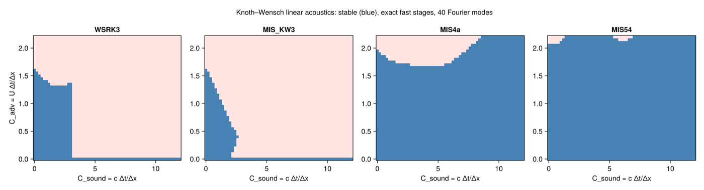

| MISDG grid, C_adv = C_sound/7 | WSRK3 | MIS4 | MIS4a | MIS54 |
|---|---|---|---|---|
| stable up to C_sound (exact fast stages) | 2.75 | > 14 | 12 | 14 |
| with `:wrf` (divergence damping), nsub = 12 | 7 | 7 | 7 | 7 |
| pulse convergence order (exact fast stages) | 2 | 3 | 3 | 4 |

- Without damping, WSRK3 is limited to C_sound ≈ 3 and MIS_KW3 is unstable for any C_sound > 0
  (ρ − 1 = 7e-6 at C_sound = 1). MIS4, MIS4a and MIS54 are stable far beyond.
- With nsub = 12 the fast loops add their own limit: at C_sound = 10 the Verlet substep exceeds
  its stability limit for every tableau. `:fb` (first order) makes MIS4 and MIS54 weakly unstable
  at C_sound = 3–7, `:verlet` does not.
- WRF's divergence damping stabilizes WSRK3 up to C_sound = 7 on this grid.

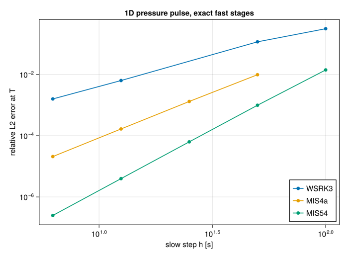

## Status and next steps

- **Cut-cell FV with MIS4:**
  - `hevi` and `rosenbrock_amf` give the same Agnesi solutions for all three hill widths.
  - `rosenbrock_amf` also runs at the large steps of the MATLAB reference: Δt = 20 s for a1,
    100 s for a10.
  - The AMF fast-step CFL is 0.65 of the regular-grid limit, because of the explicit horizontal
    acoustics inside the W-method.
- **DGSEM with `hevi_verlet`** (horizontal Störmer–Verlet around a vertical Crank–Nicolson column
  solve) runs all three Agnesi hills at the regular horizontal acoustic step (a100: dτ = 26 s,
  Δt = 313 s), about 16× fewer steps than `hevi`. `L` is the simple pointwise linearization
  (frozen θ̄ and γp/Θ, as in the HEVI Jacobian of Artiano et al. 2026). What a100 needs is the
  vertical transport of momentum by the fast vertical mass flux, −∂(ρ̄w′ v̄)/∂z, in the implicit
  vertical `L`. Left in the explicit slow part, it couples the large step to the vertical
  acoustics through the vertical Courant number U Δt/Δz (a1 0.1, a10 1.3, a100 13), and a100
  blows up. This is a stability limit of the explicit part of MIS, not of the spatial
  discretization (∂N/∂q has no growing mode). The example switches it on for U Δt/Δz > 4 (`DG_VADV_FAST`, `FV_VADV_FAST`,
  `VADV=auto|0|1`). A split-form linearization of `L` (`DG_SPLIT_FAST`, off) makes `N − L` vanish
  at rest but changes neither the stability nor the solution.
- **No background state anywhere.** All three discretizations use the full p and ρ in the
  momentum equations and the full θ in the Θ equation. The initial state is the analytic
  hydrostatic profile sampled at the points where the operator places the values (cell centres;
  for cut cells the full-cell centre, so all cells of a layer have the same p at rest). Its
  discrete imbalance is O(Δz²): at rest, after 6 h on the a10 grid, max|w| = 4e-3 m/s for
  terrain-following FV and 9e-3 m/s for cut cells. `FV_HYDRO_REFERENCE[] = true` restores the old
  p′ = p − p̄(z), ρ′ = ρ − ρ̄(z) form, which is exactly balanced at rest.
- **Terrain-following FV** runs all three hills with `hevi` at the regular step (a100: Δt = 540 s)
  with the conservative flux form (`FV_TERRAIN_FORM = :flux`). a100 needed the vertical transport
  of u by the fast vertical mass flux in the vertical `L` (U Δt/Δz = 22) and an `L` in skew form.
  - **Ground pressure in the σ-correction:** −∂_η(z_x p) took the pressure at the ground face from
    the lowest cell centre. With the full hydrostatic p that is off by ρgΔz/2, an O(1) error
    (|U_t| ≈ 0.14 at rest, not decreasing with resolution). The ground value is now extrapolated
    from the face means (`fv_p_sigma`), and the at-rest residual is second order. The fast
    operator includes the ground face in the same way (`FV_FAST_GROUND_GRADIENT`).
  - **Open: 2Δx noise along the ground at a1** (steepest slopes) with the default step Δt = 5.4 s
    (nsub = 12). It was already present before these changes. It disappears with half the slow
    step (`NSUB=6`, same fast step; see the pictures below). At double resolution the default step
    blows up and half the step runs (max|w| = 2.68). This is a stability limit of the MIS slow step
    for the terrain terms in N − L, not of the spatial discretization.
  - The flux form has a weak growing mode at rest on terrain (the x-flux carries θ along the
    sloped σ-surfaces, while the σ correction uses averaged U; ≈ 5e-6 s⁻¹ on a coarse test hill,
    growing with the horizontal resolution). It does not affect the Agnesi runs. `:advective`
    (θ ρ_t − ρv·∇θ in σ-coordinates with the state θ, adjoint pressure gradient) removes it at the
    price of Θ conservation; `:background` uses a prescribed θ̄(z).
- **Agnesi hills, all discretizations** (MIS4, nsub = 12, 200 × 64 FV cells / 50 × 16 DG elements
  of degree 4, T = 21.6 a/U):

  | | DGSEM `hevi_verlet` | FV terrain-following `hevi` | FV cut cells `rosenbrock_amf` |
  |---|---|---|---|
  | large steps | 694 | 400 | 565 |
  | a1: max\|w\|, θ′ (m/s, K) | 2.77, −1.22…0.93 | 2.54, −1.09…0.92 (2Δx noise; half step: 2.41) | 2.14, −1.08…0.91 |
  | a10 | 0.69, −1.48…1.65 | 0.56, −1.39…1.55 | 0.58, −1.43…1.58 |
  | a100 | 0.064, −1.49…1.70 | 0.056, −1.40…1.57 | 0.057, −1.43…1.61 |

  All fully background-free: no θ̄(z) (DG pointwise `L`, FV `:flux`, cut cells `:donor`) and no
  hydrostatic reference p̄, ρ̄.

### Pictures

w (top) and θ′ (bottom) at the final time, made with the commands under *Introductory cases*
(DG `hevi_verlet`, FV `hevi`, cut cells `rosenbrock_amf`; bubble with `hevi`).

| | DGSEM | FV terrain-following | FV cut cells |
|---|---|---|---|
| warm bubble, t = 120 s |  |  | 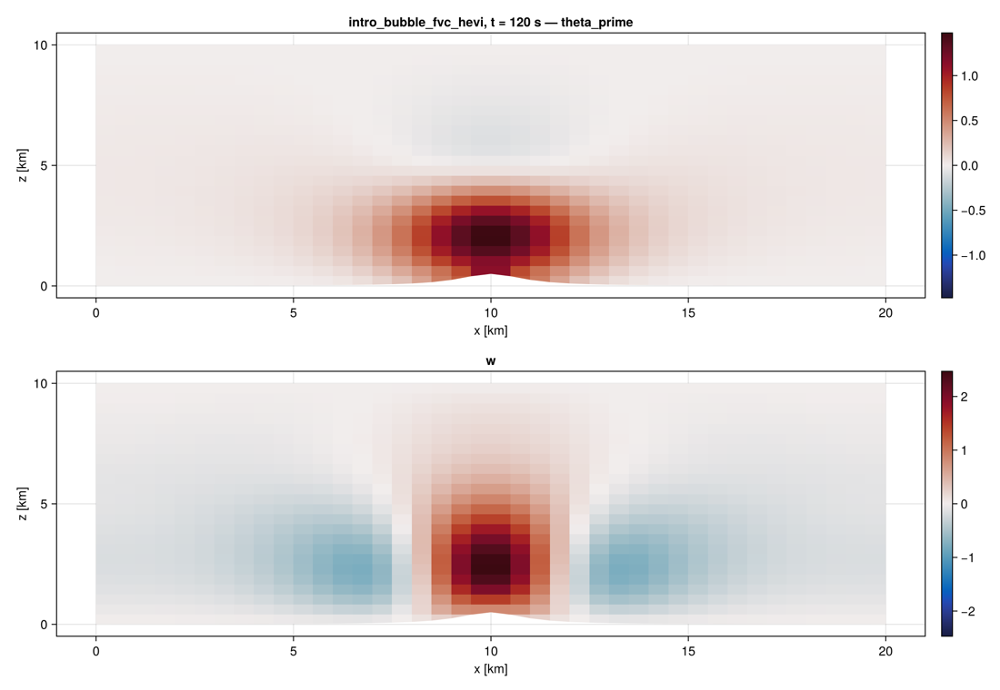 |
| Agnesi a1, t = 36 min | 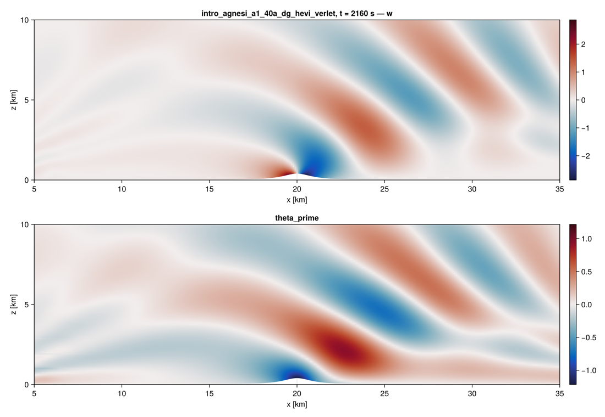 | 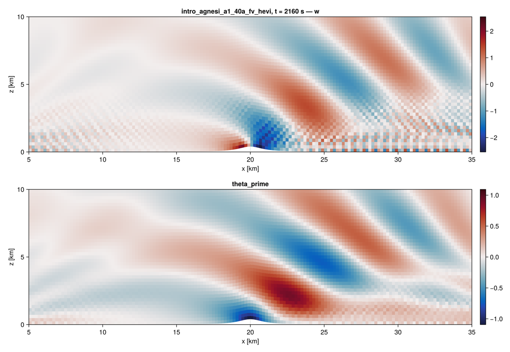 | 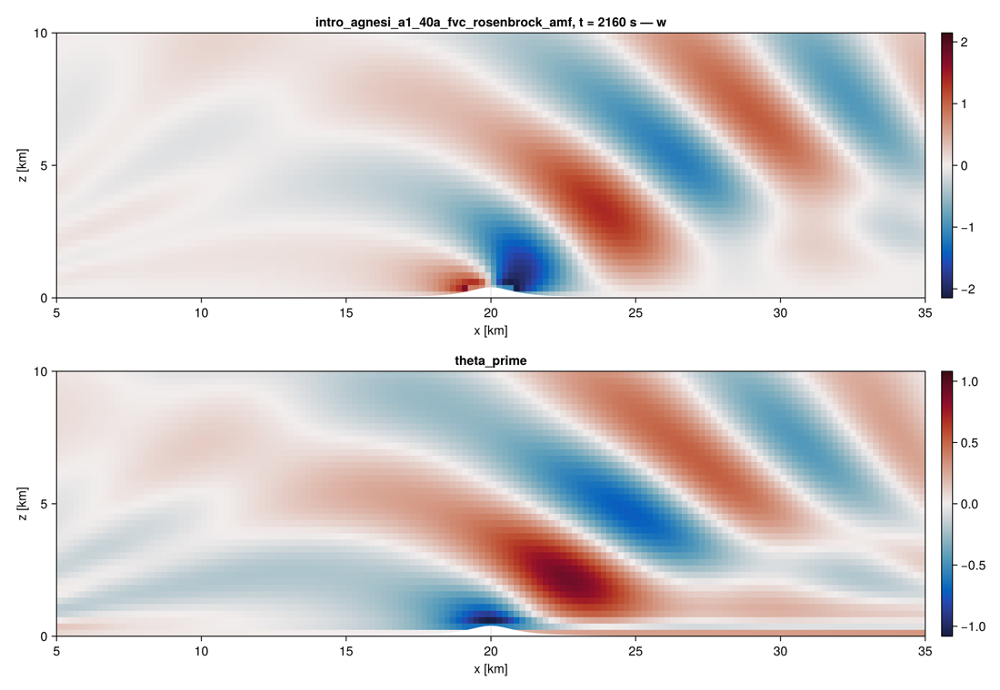 |
| Agnesi a10, t = 6 h | 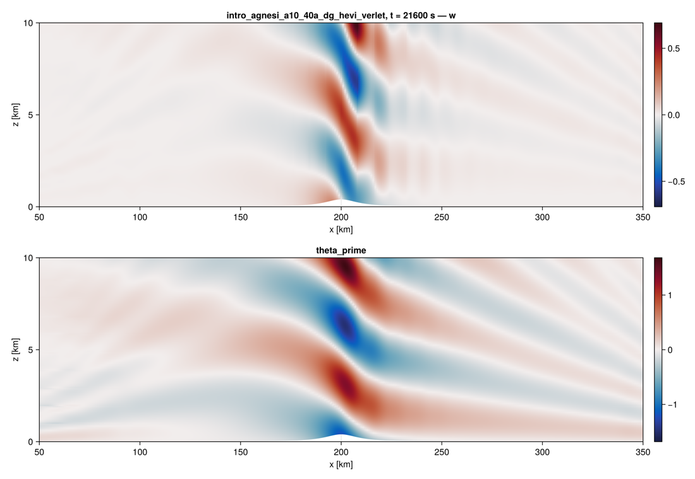 | 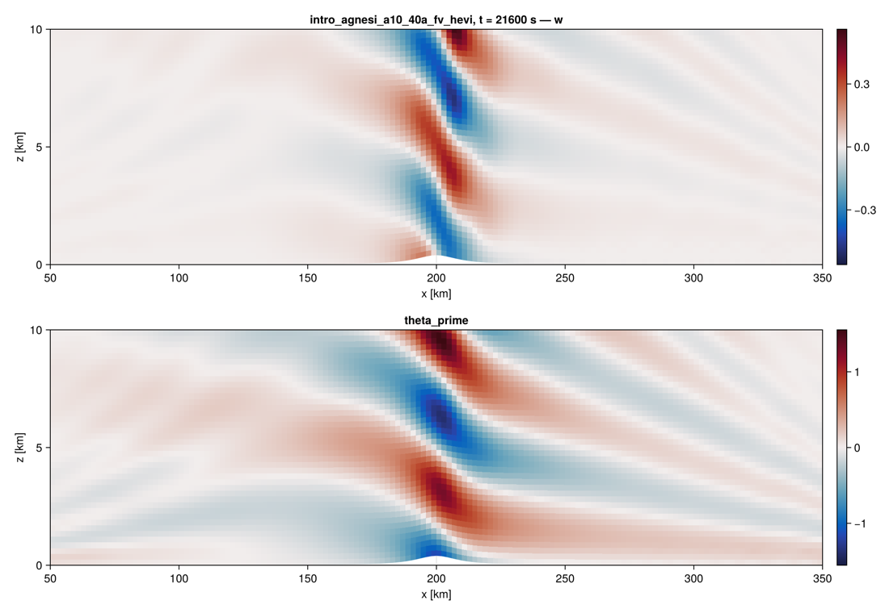 | 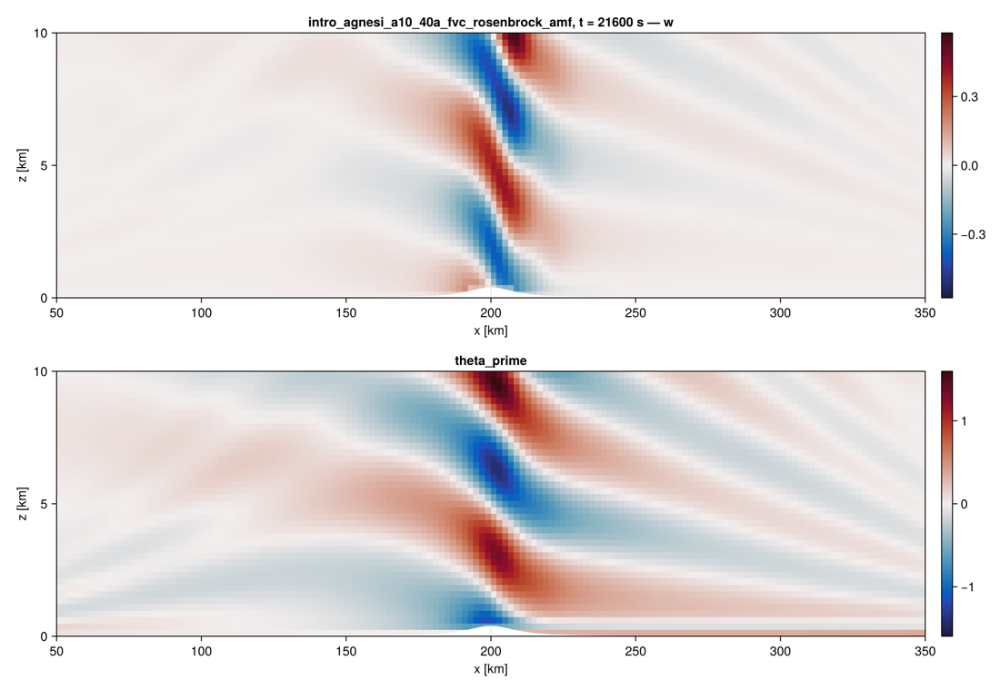 |
| Agnesi a100, t = 2.5 d | 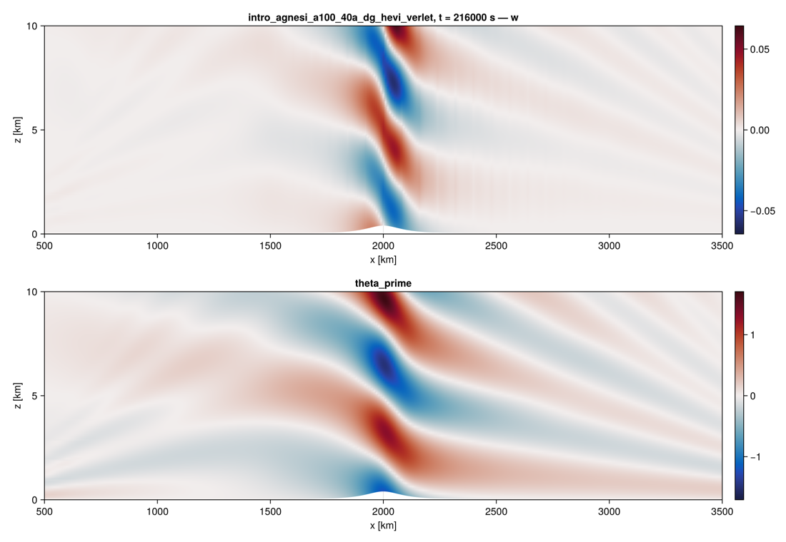 |  | 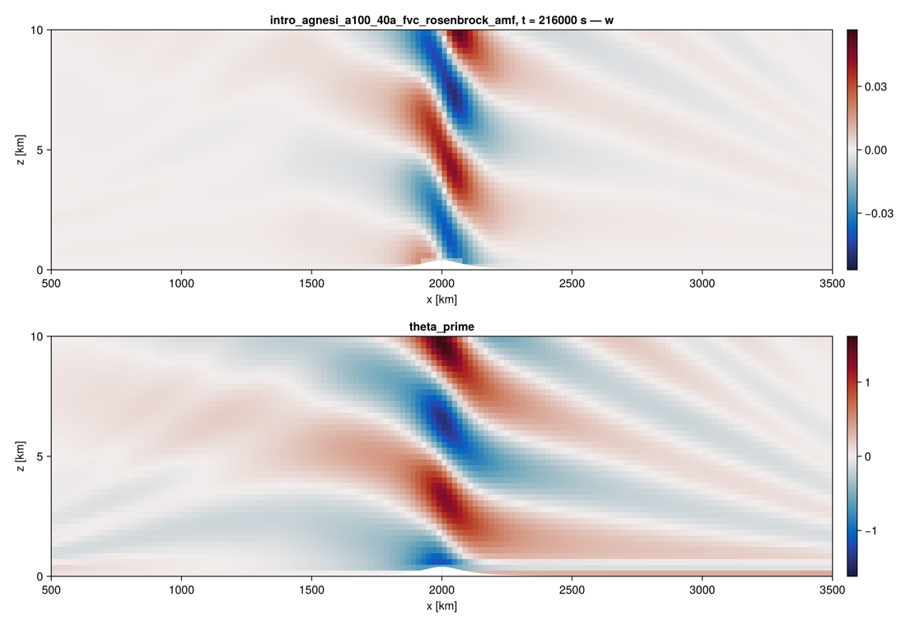 |

Terrain-following FV, a1, half the slow step (`NSUB=6`): the ground noise of the default step is gone.

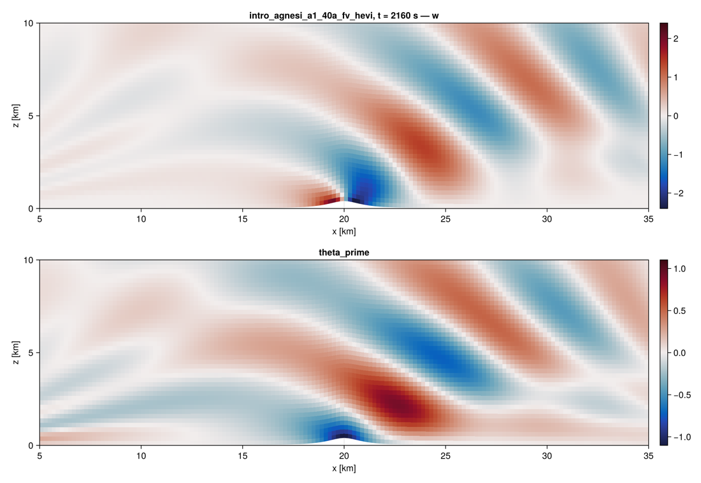

The cut-cell θ′ shows the open warm layer in the lowest cells downstream of the hill.

Production drivers (`examples/euler2d_*.jl`, flat ground, MIS4 with `hevi`, `nsub = 12`), θ′ (top) and w (bottom):

| | DGSEM | FV |
|---|---|---|
| warm bubble (20 km channel), t = 120 s |  | 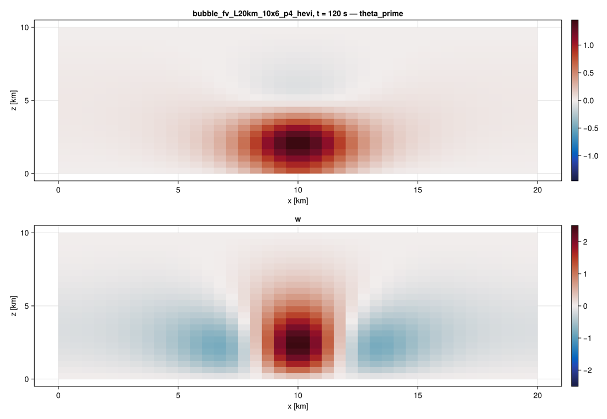 |
| gravity wave, Skamarock & Klemp, t = 3000 s | 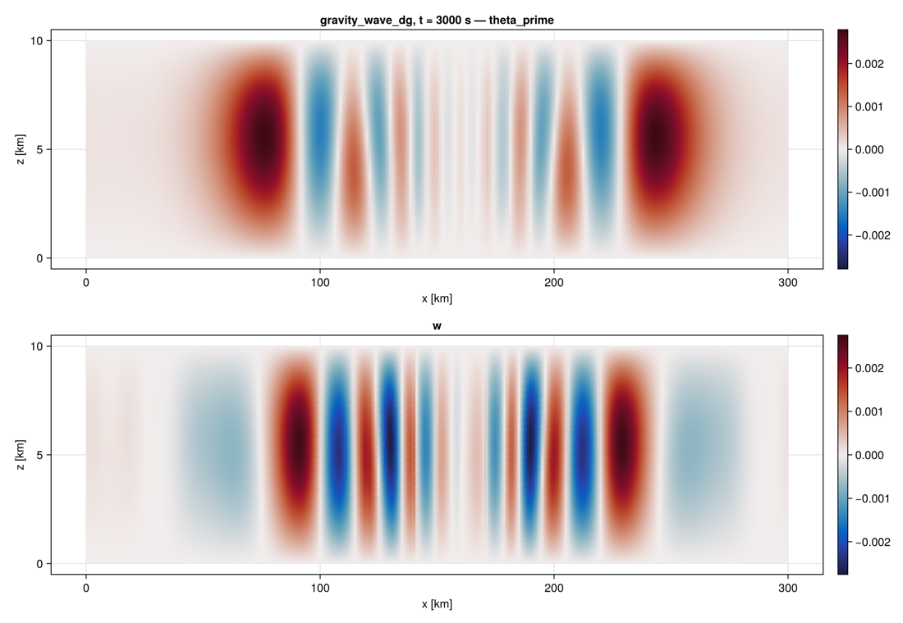 | 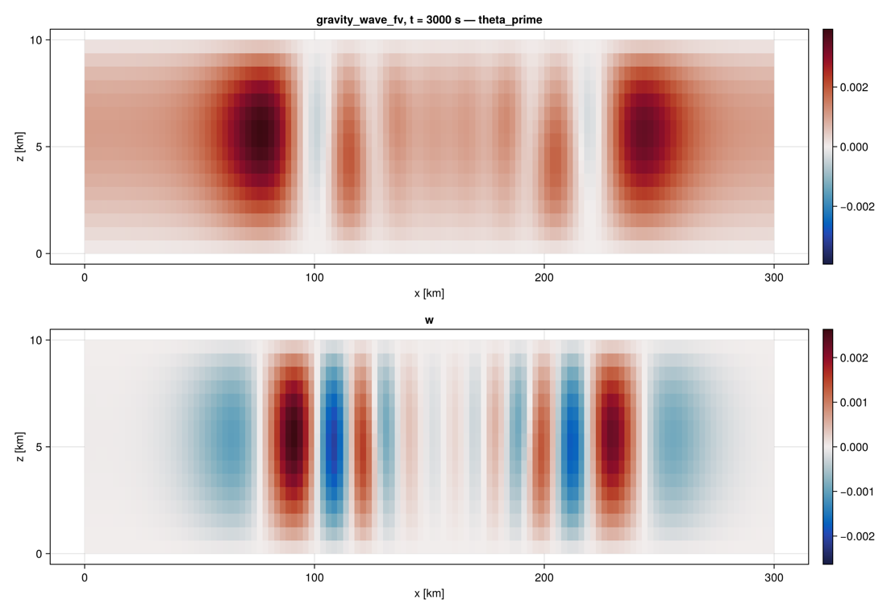 |
| long-channel gravity wave (6000 km, a = 100 km), t = 60000 s | 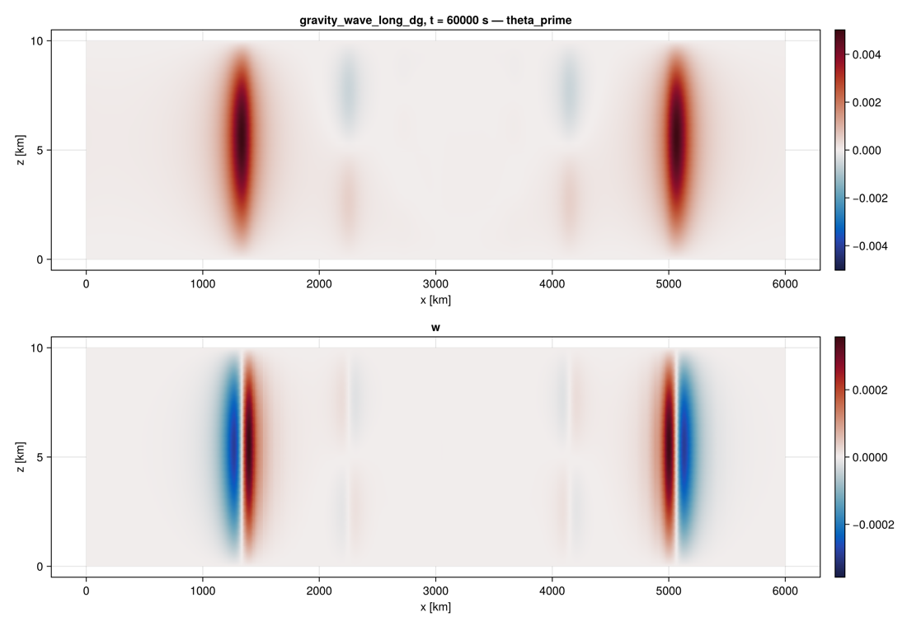 | 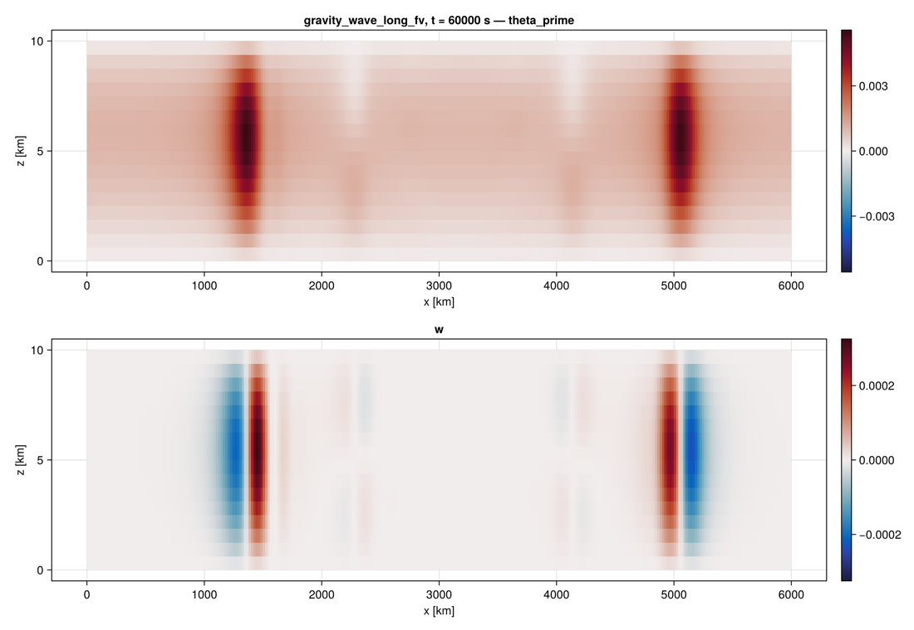 |

Long channel, FV: at Δt = 540 s the slow-step vertical Courant number is UΔt/Δz ≈ 17, so the
drivers put the vertical transport of horizontal momentum by the fast vertical velocity, −∂z(ūW′),
into `L` (`set_vadv!`, as in the Agnesi cases). Without it the step is unstable (linearized:
max |λ| = 1.16) and the packets come out lopsided (θ′ maxima 2.2e-3 and 9.0e-3 K, grid-scale noise);
with it they are symmetric (5.3e-3 and 5.3e-3 K). The analysis is in [docs/FINDINGS.md](docs/FINDINGS.md)
(§6). The faint uniform warm offset in θ′ (≈ 1e-3 K, also for a 100× smaller perturbation) is a
diagnostic offset of θ′ against θ̄(z) at the cell centres, not part of the wave.

- **Planned fast solver:** a linear IMEX fast solver as in the MATLAB reference
  (`SplitExplicitLin`/`LinIMEX_RK`). It is explicit in `L_E` and implicit in `L_I`, with one sparse
  LU of `I − γΔτ L_I`. It would replace the product of approximate factors and allow a choice of
  whether the vertical direction is implicit everywhere or only in the mask.
- **Wider choices of `L_I`:** adaptive masks, for example advection implicit where the local
  advective CFL is large, and the same splittings for DGSEM.
- **Retained HDG traces:** the 1D `HDGRelaxTheta` prototype keeps face traces with a relaxation
  equation `ε dq̂/dt = Hq − q̂`. The 2D DGSEM fast operator currently eliminates the traces; `fb`
  can relax a stored face momentum (`EPS_IF`). Long hill runs are meant to keep the relaxed traces
  together with an HEVI vertical solve.

## References

- Wensch, Knoth & Galant (2009), *Multirate infinitesimal step methods for atmospheric flow
  simulation*, BIT 49, 449–473. [DOI: 10.1007/s10543-009-0222-3](https://doi.org/10.1007/s10543-009-0222-3)
- Jebens, Knoth & Weiner (2011), *Partially implicit peer methods for the compressible Euler
  equations*, J. Comput. Phys. 230, 4955–4974. [DOI: 10.1016/j.jcp.2011.03.015](https://doi.org/10.1016/j.jcp.2011.03.015)
- Knoth (2016), *Split-explicit methods and local linear splitting*, talk at ECMWF, 3 Oct 2016.
- Wicker & Skamarock (2002), *Time-splitting methods for elastic models using forward time schemes*,
  Mon. Wea. Rev. 130, 2088–2097.
- Gallus & Klemp (2000), *Behavior of flow over step orography*, Mon. Wea. Rev. 128, 1153–1164.
- Baldauf (2021), *A horizontally explicit, vertically implicit (HEVI) discontinuous Galerkin scheme
  for the 2-dimensional Euler and Navier–Stokes equations using terrain-following coordinates*.
  [DOI: 10.1016/j.jcp.2021.110635](https://doi.org/10.1016/j.jcp.2021.110635)
- Giraldo et al. (2023), *A performance study of horizontally explicit vertically implicit (HEVI)
  time-integrators for non-hydrostatic atmospheric models*. [arXiv:2311.11425](https://arxiv.org/abs/2311.11425)
- Xu, van der Vegt & Bokhove (2008), *Discontinuous Hamiltonian finite element method for linear
  hyperbolic systems*. [DOI: 10.1007/s10915-008-9191-y](https://doi.org/10.1007/s10915-008-9191-y)
- McLachlan & Stern (2014), *Modified trigonometric integrators*.
  [DOI: 10.1137/130921118](https://doi.org/10.1137/130921118)
