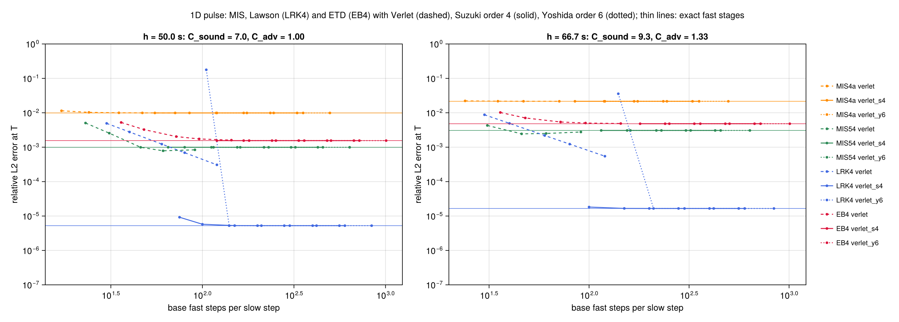
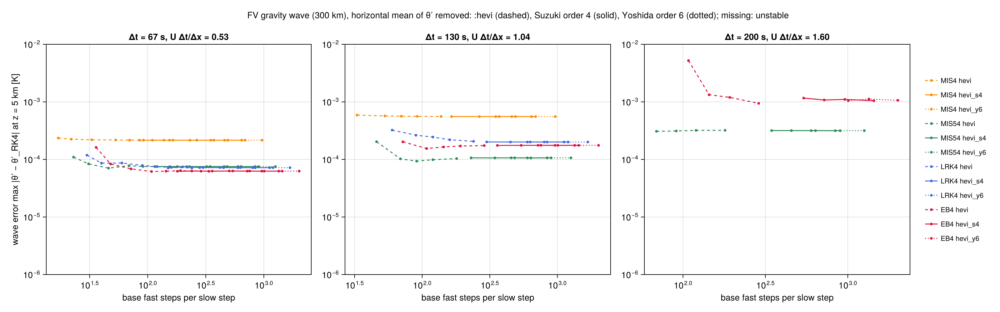
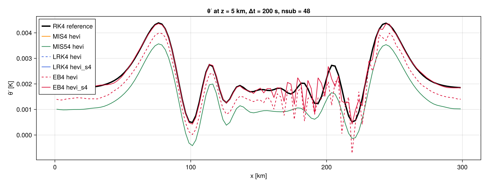
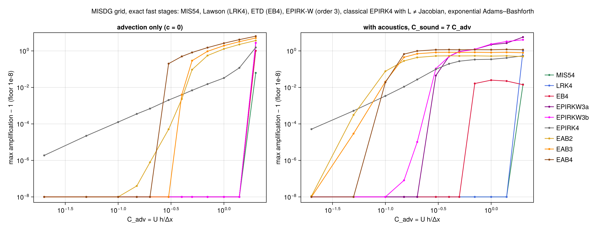
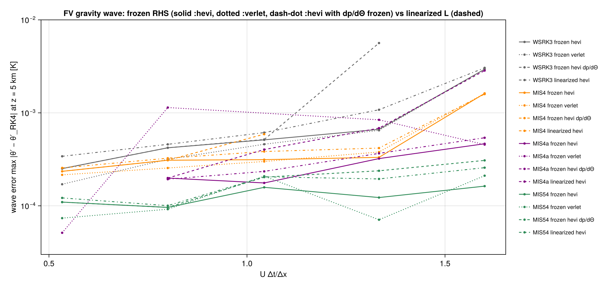
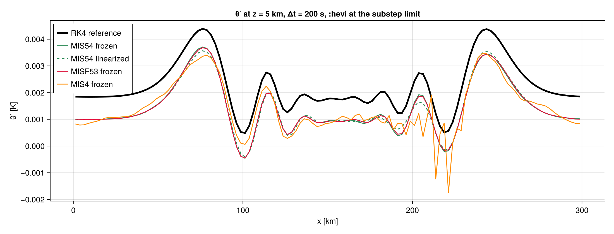

# Findings

Results of the numerical experiments, in the order they were obtained. Each entry says what was
measured, how, and what follows from it. Commands are run from the repository root.

A LaTeX version with the figures is [findings/findings.tex](findings/findings.tex)
([PDF](findings/findings.pdf)).

## 1. Discretizations without a background state

- **DG** uses the pointwise fast operator `L`; **terrain-following FV** uses the `:flux` form of
  Θ; **cut cells** use `:donor`. None of them uses θ̄(z).
- **FV without a hydrostatic reference p̄, ρ̄** (`FV_HYDRO_REFERENCE[] = false`, the default): the
  momentum equations use full p and ρ. The analytic hydrostatic initial state is balanced to
  O(Δz²) (test: residual rate > 1.9 between nz = 6 and 12).
- At rest, 6 h on the a10 grid, max|w|: terrain FV 4.1e-3 m/s (1e-11 with the reference), cut
  cells 9e-3 m/s (3e-5 with the reference).
- **Ground pressure in the Gal-Chen correction −∂η(z_x p):** the ground-face p must be
  extrapolated from the face means (`fv_p_sigma`), so that its O(Δη²) error matches the interior
  means and cancels. Pointwise 2nd/3rd-order extrapolation is only first order and gave an O(1)
  error (DomainError at rest).

## 2. Agnesi hills (h = 400 m, U = 10 m/s, N = 0.01 s⁻¹)

max|w| (m/s) and θ′ range (K) at the final time:

| | DG | FV | cut cells |
|---|---|---|---|
| a1 | 2.77, −1.22…0.93 | 2.54, −1.09…0.92 | 2.14, −1.08…0.91 |
| a10 | 0.69, −1.48…1.65 | 0.56, −1.39…1.55 | 0.58, −1.43…1.58 |
| a100 | 0.064, −1.49…1.70 | 0.056, −1.40…1.57 | 0.057, −1.43…1.61 |

- **a1, terrain FV:** 2Δx noise near the ground at the default step. It disappears with half the
  slow step (`NSUB=6`, max|w| 2.41), so it is an MIS slow-step limit on terrain terms left in
  `N − L`, not a spatial defect. It is also present with the hydrostatic reference and with the
  `:advective` Θ form. At twice the resolution the default step blows up; `NSUB=6` is stable (2.68).
- **Cut cells:** a warm layer of ≈ 0.35 K in the lowest cells downstream of the hill (a10), open.
- U ≠ 0 runs without the reference drift in mass by ≈ 2.5e-5 (3.7e-7 with it); attributed to the
  sponge relaxing to a q0 that is not a discrete equilibrium, not investigated further.

## 3. Gravity waves (Skamarock & Klemp 1994, flat ground)

`examples/euler2d_gravity_wave.jl` (300 km) and `examples/euler2d_gravity_wave_long.jl` (6000 km,
a = 100 km, Δx = 20 km, Δz = 625 m, U = 20 m/s, T = 60000 s), MIS4, `hevi`, nsub = 12:

- 300 km: DG and FV symmetric (θ′ maxima 2.73e-3/2.72e-3 K DG, 3.78e-3/3.32e-3 K FV).
- **6000 km, FV at the default step** Δt = 540 s (NΔt ≈ 5.4, UΔt/Δx = 0.54, cΔt/Δx ≈ 9.5):
  asymmetric packets (θ′ maxima 2.2e-3 and 9.0e-3 K) and grid-scale noise between them. Identical
  with the hydrostatic reference and on the commit before the background was removed, and with
  `:hevi` and the default solver. With `NSUB=3` (Δt = 135 s, same dτ) the packets are symmetric
  (5.9e-3, 4.8e-3 K) and the noise is gone. DG is clean at the default step (4.9e-3/4.9e-3 K).
  Since dτ is the same in both runs, the error comes from the slow step, not from the fast solver.
- **Cause and fix (§6):** the vertical transport of horizontal momentum by the fast vertical
  velocity, −∂z(ūW′), was left in the slow part although UΔt/Δz ≈ 17. The Agnesi driver puts it
  into L for UΔt/Δz > 4, the production gravity-wave drivers did not apply that criterion. With
  `set_vadv!` (now in all drivers) the default step gives θ′ maxima 5.34e-3 / 5.29e-3 K and an
  asymmetry of 4.4e-4 K (6.9e-3 K before). The 300 km case (UΔt/Δz = 2.1) and DG (0.6) are unchanged.
- The uniform ≈ 1e-3 K warm offset of θ′ in these runs is present also for a 100× smaller
  perturbation and for U = 0: a diagnostic offset of θ′ against θ̄(z) at the cell centres, not part
  of the wave (not the k = 0 part of the perturbation, as first assumed).

## 4. MIS tableaus

`TimeStepping.mis_observed_order` (exact fast stages, L and S not commuting) and `rk_order`
(L = 0):

| | WSRK3 | MIS2 | MIS3C | MIS4 | MIS4a | MIS_KW3 | MIS54 |
|---|---|---|---|---|---|---|---|
| RK order (L = 0) | 2 | 2 | 3 | 3 | 3 | 3 | 4 |
| MIS order | 2 | 2 | **2** | 3 | 3 | 3 | 4 |
| fast time Σ dᵢ / Δt | 1.83 | 1.19 | 1.19 | 1.44 | 1.47 | 1.00 | 1.88 |

- **MIS3C** (coefficients as in ClimaTimeSteppers.jl) is only second order once L ≠ 0: a coupling
  condition fails. To be checked against Knoth & Wensch (2014).
- **MIS54** (Bauer & Knoth 2021, from MISDG) is fourth order; it runs in the FV gravity-wave test.

## 5. Linear acoustics with advection (`MultiRate.LinearAnalysis`)

The MISDG talk these experiments come from is in [talks/](talks/README.md).
`examples/linear_analysis/mis_stability.jl`; amplification matrices per Fourier mode, computed by
running the production `mis_step!` and fast loops on unit vectors.

- **Knoth–Wensch test (exact fast stages):** pure advection is stable to C_adv = 1.63 (3-stage
  methods) and 2.06 (MIS54). Undamped WSRK3 is unstable from C_sound ≈ 3.2, MIS_KW3 from ≈ 2
  (and for any C_sound at C_adv = 1). MIS4a and MIS54 are stable on the whole box C_sound ≤ 12.
- **MISDG grid** (4th-order staggered acoustics, 5th-order upwind advection, C_adv = C_sound/7),
  exact fast stages: WSRK3 stable to C_sound = 2.75, MIS4 beyond 14, MIS4a to 12, MIS54 to 14.
  MIS_KW3 is weakly unstable for every C_sound (ρ − 1 = 7e-6 at C_sound = 1). Same as in MISDG.
- **Fast loops with nsub = 12:** `:verlet` and `:fb` reproduce the exact-stage result as dτ → 0
  (orders 2 and 1). At C_sound = 10 the Verlet substep exceeds its own limit for every tableau.
  `:fb` makes MIS4 and MIS54 weakly unstable at C_sound = 3–7, `:verlet` does not. WRF divergence
  damping (`:wrf`) stabilizes WSRK3 up to C_sound = 7.
- **Pulse convergence** (exact fast stages): orders 2 (WSRK3), 3 (MIS4a), 4 (MIS54).
- Consequence: pure acoustics + advection does not explain the slow-step limits of §2 and §3; the
  MIS methods in use (MIS4, MIS4a) are stable far beyond the Courant numbers of those runs.

## 6. Linearized production models: the long-channel failure (`fv_gravity_wave_split.jl`)

`examples/linear_analysis/fv_gravity_wave_split.jl`. The flat FV model is invariant under shifts
in x. `LinearAnalysis.linearized_mode_model` builds, per horizontal Fourier mode, the column
blocks (63 × 63) of the Jacobian J of `rhs_nonlinear!` (central differences) and of the frozen fast
operator L and its vertical part; `step_matrix` runs the production MIS step on them. The
eigenvalues of all blocks together equal those of the full `fast_matrix` (test).

**Steps that led to the cause:**

1. The real FV run is linear in the amplitude: with Δθ = 1e-4 instead of 1e-2 the packet asymmetry
   scales by 1e-2 (7.0e-5 K). With U = 0 the asymmetry is 1e-5 K (1e-7 K for Δθ = 1e-4).
2. A constant-coefficient model with the FV grids (`boussinesq_symbols`: compressible Boussinesq,
   C-grid, Lorenz grid, rigid lid, buoyancy and acoustics in L, advection in S) is accurate at
   Δt = 540 s: max error 1.5e-4 of a 4.5e-3 K packet with the FV `:hevi` loop. Moving the advection
   of any rows between L and S, or anti-advecting u in L, changes this by at most 1.4%. So the
   failure is not in the generic acoustic-gravity-advection problem.
3. The linearized production FV reproduces the nonlinear run exactly (θ′ maxima 1.319e-3 /
   8.017e-3 K vs 1.320e-3 / 8.022e-3 K with the reference). The exact linear solution is
   symmetric (4.50e-3 / 4.46e-3 K). With exact fast stages the error remains (6.1e-3 / 2.8e-3 K), so
   it is the slow-step coupling, not the fast solver; the `:hevi` loop adds instability
   (max |λ| = 1.15, growth up to 0.15 per step at 4Δx–8Δx).
4. Moving S rows into L, exact fast stages, Δt = 540 s: the horizontal-momentum rows reduce the
   error from 1.67e-3 to 2.8e-5 K, the Θ rows do nothing. Writing L's mass and Θ fluxes with the
   perturbation momentum m − ūρ (L as primitive acoustics) does nothing either.
5. The stiff part of S's momentum rows is the vertical transport −∂z(ūW′) with coefficient
   ūΔt/Δz ≈ 17 — the term that `FV_VADV_FAST` already puts into L (§2, a100).

**Result** (MIS4, nsub = 12 / 3, modes j ≤ 60 of 300; 2.8e-5 K is the truncation floor):

| L | fast | Δt [s] | packets [K] | max err [K] | max \|λ\| |
|---|---|---|---|---|---|
| as in the driver (no vadv) | exact | 540 | 6.13e-3 / 2.80e-3 | 1.7e-3 | 1.0000 |
| | `:hevi` | 540 | 1.36e-3 / 7.99e-3 | 4.0e-3 | 1.151 |
| | `:hevi` | 135 | 4.94e-3 / 3.91e-3 | 5.6e-4 | 1.0034 |
| vertical u-transport in L | exact | 540 | 4.55e-3 / 4.38e-3 | 1.2e-4 | 1.0000 |
| | `:hevi` | 540 | 4.42e-3 / 4.38e-3 | 3.7e-4 | 1.0000 |
| | `:hevi` | 135 | 4.46e-3 / 4.47e-3 | 2.0e-4 | 1.0000 |
| all S momentum rows in L | `:hevi` | 540 | 4.42e-3 / 4.76e-3 | 4.5e-4 | 1.0015 |

exact linear: 4.50e-3 / 4.46e-3 K. Regression test: a 30-column grid with the same Δx, Δz, Δt has
max |λ| > 1.1 at 7.5Δx without vadv and < 1 with it.

**Consequences:**

- The vadv criterion (UΔt/Δz > 4) is a property of the step, not of a test case: it is now applied
  by every driver through `set_vadv!`.
- Constant-coefficient model problems (§5, step 2) are good for the tableaus and fast loops but
  missed this; the linearized production operator is the reliable diagnostic. It needs
  shift invariance in x, so terrain (the a1 noise of §2, UΔt/Δz = 0.2, a different mechanism) needs
  the matrix-free variant (Arnoldi on the linearized step) still to be written.
- With `:wrf` (WRF's off-centred vertical step and divergence damping) instead of `:hevi`, the
  default step is stable without vadv (max |λ| = 1.0014) but still inaccurate (3.6e-3 / 5.7e-3 K).

## 7. Matrix-free analysis of the linearized step (preliminary, terrain paused)

`LinearAnalysis.linearized_step(model, qb, Δt, tab; nsub, fast)` applies the linearized
production MIS step (fast operator frozen at qb, central differences of `mis_step!`) to a vector;
it needs no shift invariance. `arnoldi_eigs` (restarted Arnoldi) finds the eigenvalues of largest
modulus of such a map.

- On the a1 terrain-FV grid (51k unknowns) Arnoldi on the step itself does not converge: almost
  all eigenvalues lie near the unit circle. Power iteration (repeated application) works.
- First result, a1 FV linearized about the initial state, MIS4, `:hevi`: growth 1.027 per step at
  the default step (`NSUB=12`, Δt = 5.4 s), 1.0001 (neutral) at `NSUB=6`. The growing mode is a
  2–3Δx oscillation of U and W in the lowest three levels on the steep flanks (slope ±0.25), where
  the noise of §2 appears. Not yet separated: fast loop vs slow-step coupling, and which terrain
  term of S = N − L is responsible. Paused (no orography tests for now).

## 8. Lawson RK with the MIS fast integrators as propagator

`TimeStepping.LawsonTableau` (`:LRK4` classical RK4, `:LRK3` Kutta, `:LRK2` midpoint; selectable by
name like the MIS tableaus, env `TABLE` in the drivers). With the fast flow φ_τ of the frozen L
(including its constant forcing) and S = N − L:
Y_i = φ_{c_iΔt}(qⁿ) + Δt Σ_j a_ij e^{(c_i−c_j)ΔtL} S(Y_j). The propagator is the fast loop of the MIS
step (`fast_solve!` without slow forcing, dτ ≈ Δt/nsub); φ_{cΔt}(qⁿ) is computed once per node.
`mis_step!` dispatches on the tableau type, so `run_mis`, the drivers and `LinearAnalysis` work
unchanged. Fast integration time per step: LRK4 2.5 Δt (MIS4 1.44 Δt).

- **Order** (exact propagators, non-commuting test): LRK2 2, LRK3 3, LRK4 4. With the Verlet loop
  the step converges to the exact one at order 2 in dτ.
- **Linear stability:** limited by the advection Courant number as for RK4 — C_adv ≤ 1.75 (LRK4),
  1.62 (LRK3) on the Knoth–Wensch test (MIS54 2.06); stable fraction of the box 0.78 (MIS54 0.99).
  On the MISDG grid (C_adv = C_sound/7) LRK4 with Verlet, nsub = 12, is stable up to C_sound = 10,
  where MIS4 and MIS54 with Verlet are already unstable (equal-length Lawson propagations vs the
  rounding of d_i nsub in MIS); |ρ| − 1 ≈ 1e-8 vs 1e-5 for MIS4.
- **Accuracy, exact propagators:** pulse error 190× smaller than MIS54 at the same step
  (5.3e-6 vs 9.9e-4), order 4. Lawson is exact for S = 0; MIS with α, γ ≠ 0 is not: for an
  unbalanced initial state (the gravity-wave θ′ at constant pressure) all MIS tableaus damp or
  dephase the fast acoustic part by a Δt-independent amount (4e-3 relative in the linear
  Boussinesq wave, also for the k = 0 mode), Lawson keeps it (5e-13).
- **Accuracy with the real fast loops:** the propagator error enters directly. Pulse with Verlet:
  LRK4 error = the 2nd-order Verlet error (rates 2.00), the same as MIS54. Nonlinear FV gravity
  wave (300 km, `:hevi`) against explicit RK4 on N: max θ′ error 1.6e-3 / 1.7e-3 / 3.7e-4 K at
  Δt = 67 / 34 / 17 s for LRK4, 1.1e-3 / 8.6e-4 / 6.0e-4 K for MIS4 (max θ′ 4.4e-3 K). All
  methods are dominated by the fast-loop error (vertical Crank–Nicolson at large vertical Courant
  numbers).
- **Consequence (revised in §9):** with second-order fast loops the Lawson error at small slow
  steps is the fast-loop error. The comparison above mixes the gravity wave with an oscillation of
  the horizontal mean (see §9); at large slow steps and with a fourth-order fast loop the picture
  is different.

## 9. ETD, high-order fast loops, MIS vs Lawson/ETD at large slow steps, optimal number of substeps

**ETD in stage-ODE form** (`TimeStepping.ETDTableau`, after the MATLAB `SplitExplicitETD.m` /
`MethodETD.m`): stage i starts from qⁿ and integrates Z' = L Z + Σ_j Σ_k P_ijk τ^{k−1} S(Y_j) over
c_iΔt, τ the normalized local time, P = a/((k−1)! c_i) from the φ_k coefficients a. Exactly
integrated this is the ETD stage e^{c_iΔtL}qⁿ + Δt Σ a_ijk φ_k(c_iΔtL) S_j. Tableaus :EB1, :ETD2
(Cox–Matthews), :EB4 (Krogstad ETDRK4); fast time 3Δt per step for EB4. `fast_solve_poly!` runs
the fast loops with the forcing taken at the midpoint of every base step, which keeps symmetric
loops symmetric in (q, t). Orders with exact fast stages: 1, 2, 4.

**High-order fast loops:** `:<base>_y4` (Yoshida triple jump, weights 1.35, −1.70), `:<base>_s4`
(Suzuki, 5 stages, |w| ≤ 0.66, stable at the regular substep), `:<base>_y6` (Yoshida, 7 stages)
compose a symmetric loop (`:verlet`, FV `:hevi`, `:hevi_verlet`); orders 4, 4, 6 also with the
time-dependent ETD forcing. Suzuki's error constant is 60× smaller than the triple jump's.

**Linear pulse at large steps** (`examples/linear_analysis/lawson_mis_pulse.jl`, h = 50 s,
C_sound = 7, C_adv = 1; relative error at T):

| | exact fast stages | Verlet, nsub = 48 | Suzuki, nsub = 8 |
|---|---|---|---|
| MIS4a | 9.9e-3 | 9.9e-3 | 9.9e-3 |
| MIS54 | 9.9e-4 | 8.4e-4 | 1.0e-3 |
| EB4 | 1.6e-3 | 1.6e-3 | 1.6e-3 |
| LRK4 | **5.3e-6** | 3.1e-4 | **5.8e-6** |

**Nonlinear FV gravity wave at large steps** (`examples/lawson_mis_gravity_wave.jl`, 300 km,
reference explicit RK4 on N). The initial θ′ at constant pressure is not balanced and excites a
vertical acoustic oscillation of the horizontal mean of θ′ (≈ 1e-3 K at z = 5 km). RK4, Lawson
and ETD keep it, MIS damps it (sections below: the MIS54 curve is shifted). The *wave error*
(horizontal mean removed) at the best number of substeps:

| wave error [K] | Δt = 67 s (UΔt/Δx = 0.53) | 130 s (1.04) | 200 s (1.6) |
|---|---|---|---|
| MIS4 `hevi` | 2.2e-4 | 5.6e-4 | unstable |
| MIS54 `hevi` | 7.5e-5 | **1.0e-4** | **3.2e-4** |
| LRK4 `hevi_s4` | 7.2e-5 | 2.0e-4 | unstable |
| EB4 `hevi_s4` | **6.3e-5** | 1.8e-4 | 1.1e-3 |

The total error (with the mean): MIS 0.9–1.4e-3 K at all steps; LRK4/EB4 with `hevi_s4`
6–9e-5 (67 s), 1.6–2.1e-4 (130 s); with `hevi` (second order) erratic, 1e-4 … 1.7e-3.

**MIS vs Lawson/ETD:**

- MIS solves each stage as Z' = LZ + constant forcing, i.e. it is an ETD method with φ-functions
  built from the stage structure; with α, γ ≠ 0 it is not exact for S = 0 and damps or dephases
  fast modes at ωΔt ≫ 1 by a Δt-independent amount. Lawson and ETD are exact for S = 0 and keep
  the fast modes.
- Where the fast modes are the signal (the acoustic pulse) Lawson with an accurate propagator is
  far better (170× below MIS54). ETD (EB4) is not (1.6e-3); a plausible reason: its polynomial-in-time
  forcing interpolates S along the fast oscillation, Lawson interpolates in the frame moving with e^{tL}.
- Where the slow modes are the signal (gravity wave) MIS54 is as accurate as LRK4/EB4 at
  UΔt/Δx ≈ 0.5, more accurate at ≈ 1, and the only one of them stable at 1.6 (EB4 stable but 3×
  worse). MIS54 needs no high-order fast loop, so it is 5–8× cheaper per step.
- Stability limits in UΔt/Δx: MIS54 > 1.6; LRK4 and MIS4 < 1.6 (LRK4's RK4 advection limit 1.75
  on the linear test); EB4 1.6 but inaccurate.

**Optimal number of substeps:**

- *MIS:* the error does not depend on the fast loop once the substep is stable: the same error
  with `hevi`, `hevi_s4`, `hevi_y6` and for every nsub. The optimum is the smallest stable nsub,
  dτ at the acoustic limit (nsub = Δt/dτ_max); at most a margin of ~1.5 (MIS54 at Δt = 67 s:
  1.1e-4 at nsub = 12, 7.1e-5 at nsub = 24). A higher-order fast loop is wasted.
- *Lawson/ETD:* the wave error behaves like MIS (independent of the fast loop at the smallest
  stable nsub), but the fast part — and with it the total error — needs a fourth-order loop:
  `_s4` at the smallest stable nsub (its weights |w| ≤ 0.66 allow the regular dτ) reaches the
  exact-propagator error; more substeps or `_y6` bring nothing. Cost 5× the second-order loop.
  With a second-order loop the error decreases only like (Δt/nsub)² and needs nsub ≳ 4× larger.

## 10. EPIRK(-W) and exponential Adams–Bashforth with the MIS fast loops

**Methods** (`src/TimeStepping/epirk.jl`). Both are written in the stage-ODE form of §9, so the
φ-function combinations that KIOPS evaluates in the EPI/EPIRK codes of Tokman and Gaudreault are
fast integrations with a polynomial forcing (`fast_solve_poly!`):

- **EPIRK** (`EPIRKTableau`): Y_i = qⁿ + a_i1 ψ_1(g_i1 hL) h N(qⁿ) + Σ_j a_ij ψ_j(g_ij hL) h Δ^{(j−1)}r,
  ψ_j = Σ_k p_jk φ_k, r(y) = N(y) − N(qⁿ) − L(y − qⁿ) = S(y) − S(qⁿ). For each distinct g > 0 in a row
  one fast integration from qⁿ over gh of W' = LW − Lqⁿ + Σ_k τ^{k−1} G_k, with
  G_k = Σ_j a_ij p_jk V_j/((k−1)! g); terms with g = 0 are explicit. Tableaus (Narayanamurthi,
  Tranquilli, Sandu, Tokman, J. Sci. Comput. 2019): `:EPIRKW3a`, `:EPIRKW3b` (EPIRK-W, order 3
  for any L; fast time 2.27h and 1.35h per step) and `:EPIRK4` (the classical order-4 method of
  their epirkk4 coefficients, order 4 only for L = ∂N/∂q; fast time 3.06h).
- **Exponential Adams–Bashforth** (`EABTableau`, `:EAB2`…`:EAB4`; Hochbruck & Ostermann 2010), the
  multistep form of Gaudreault's EPI methods for an arbitrary L: one fast integration per step,
  Y' = LY + p(τ) from qⁿ over h, p the polynomial through S(q^{n−m}) at τ = −m, all S with the
  current frozen L (S(q^{n−m}) = N(q^{n−m}) − L_n q^{n−m}; the history stores q and N). Start-up: EB4.
  Fast time 1·h per step and one N evaluation per step.

**Orders** (exact fast stages, non-commuting test problem, L ≠ Jacobian): EPIRKW3a 3.0, EPIRKW3b
3.0, EAB2/3/4 2.0/3.0/3.95; EPIRK4 0.97 (1st order), and 3.9 with L = Jacobian. The production
step agrees with the exact φ-functions; with `verlet_s4` it converges with order 4.

**Stability** (`examples/linear_analysis/epirk_eab_stability.jl`, MISDG grid, exact fast stages;
maximum amplification):

| C_adv (C_sound = 7 C_adv) | 0.1 | 0.2 | 0.3 | 0.5 | 1.0 |
|---|---|---|---|---|---|
| MIS54, LRK4 | 1 | 1 | 1 | 1 | 1 |
| EB4 | 1 | 1 | 1 | 1 | 1.025 |
| EPIRKW3a / W3b | 1 | 1 | 1.04 / 1.11 | 1.9 | 3.2 / 3.4 |
| EPIRK4 (L ≠ J) | 1.003 | 1.03 | 1.10 | 1.27 | 1.35 |
| EAB2 / EAB3 / EAB4 | 1.08 / 1.02 / 1.02 | 1.4 / 1.7 / 2.0 | 1.5 / 1.8 / 2.2 | 1.5 / 1.8 / 2.2 | 1.5 / 1.8 / 2.2 |

Without acoustics EPIRK-W is stable up to C_adv = 1.4 and EAB2/3/4 up to the Adams–Bashforth
limits ≈ 0.4/0.4/0.2: the instability comes from the coupling with the fast acoustics.

**Nonlinear FV gravity wave** (300 km, RK4 reference, `hevi`, nsub at the acoustic limit; wave error [K]):

| Δt [s] (UΔt/Δx, cΔt/Δx) | 67 (0.53, 9.3) | 33 (0.27, 4.7) | 20 (0.16, 2.8) | 10 (0.08, 1.4) | 5 (0.04, 0.7) | 2.5 | 1 |
|---|---|---|---|---|---|---|---|
| MIS54 | 1.1e-4 | 1.1e-4 | 1.1e-4 | 7.0e-5 | | | 4.2e-6 |
| EB4 | 1.6e-4 | 1.2e-4 | 9.1e-5 | 9.0e-5 | 8.8e-5 | 3.6e-5 | 4.2e-6 |
| EPIRKW3a | unstable | unstable | 1.2e-2 | unstable | | | |
| EPIRKW3b | unstable | unstable | unstable | 8.4e-5 | unstable | 3.6e-5 | 4.2e-6 |
| EPIRK4 | 8.0e-4 | 2.7e-3 | 4.3e-4 | 1.6e-4 | | | |
| EAB2/3/4 | unstable | unstable | unstable | unstable | unstable | 7.8e-3 / 3.7e-5 / – | 4.2e-6 |

All converge to the same solution at small steps (the implementation is right), but EPIRK-W and
EAB are usable only at slow steps where the acoustics would almost be resolved (cΔt/Δx ≲ 0.5),
which defeats the multirate idea.

**Why:**

- The W-order of EPIRK-W is a classical (non-stiff) order for an arbitrary matrix; nothing controls
  the method for ‖hL‖ ≫ 1. Narayanamurthi et al. note themselves that A = J may be needed for
  stability. In their applications A is (an approximation of) the full Jacobian, and the step is
  limited by accuracy, not by a fast/slow split.
- EAB extrapolates S from the previous steps. Through the coupling with advection S carries the
  fast acoustic oscillation, and polynomial extrapolation of e^{iωt} over ωh ≫ 1 amplifies it.
  ETD-RK (EB4) interpolates only within the step, Lawson in the frame moving with e^{tL}.
- The classical EPIRK4 with L instead of the Jacobian is first order; using the real Jacobian would
  need a Jacobian-vector product of the slow part in every fast substep.

**Consequence:** of the exponential methods, keep Lawson (LRK4) and ETD-RK (EB4) next to MIS. A
multistep method with one slow evaluation per step would need the Lawson form (integrating-factor
Adams–Bashforth: extrapolate e^{(t_n−t)L}S, i.e. propagate the stored S by the fast flow; k fast
integrations per step) — not tried yet.

## 11. MIS with a frozen part of the right-hand side (flat FV)

**Idea** (Knoth & Wensch, *B-series and split-explicit methods*, github.com/OsKnoth/B-Series;
MATLAB `SplitExplicit.m`): instead of adding and subtracting a linearized fast operator
(S = N − L_n, fast Z' = L_n Z + forcing), write the right-hand side with two arguments,
N(q) = F(q, q), the first frozen at the stage values, the second evolving in the fast
integration:
Z_i' = Σ_j w_ij F(Y_j, Z_i) + Σ_j γ_ij/(d_iΔt)(Y_{j+1} − qⁿ), w_ij = β_ij/d_i, over d_iΔt from
qⁿ + Σ_j α_ij(Y_{j+1} − qⁿ) (`TimeStepping.run_frozen`, `frozen_mis_step!`). For an additive
F(y, z) = S(y) + G(z) this is the usual MIS step.

**FV split** (`src/FV/frozen.jl`, flat grids only):
- fast, evolving z: ρ_t = −∂xU − ∂zW, Θ_t = −∂x(θx U) − ∂z(θz W), U_t = −∂x p'(Θ),
  W_t = −∂z p'(Θ) − g ρ', with the full nonlinear p(Θ), and the sponge;
- frozen coefficients C(y): the upwinded (3rd-order) face values θx, θz of the full operator,
  upwind direction from y; linear in C, so Σ_j w_j F(Y_j, Z) = F_f(Σ_j w_j C(Y_j), Z) + Σ_j w_j S(Y_j);
- slow, frozen y: momentum advection.
F(q, q) = N(q) to rounding (4e-16 relative). Nothing is linearized and there is no reference state.

**What is frozen** (y stage values, z fast state): (1) the 3rd-order upwind face θ of the Θ fluxes,
from θ = Θ/ρ of y, upwind direction from y, weighted sum Σ_j (β_ij/d_i) θ_face(Y_j); (2) the momentum
advection, once per stage, as constant forcing. Live in every substep: mass fluxes, Θ fluxes
θ_face·(U, W) with the current U, W, the nonlinear p(Θ), gravity, sponge. Only the Jacobian of the
implicit vertical CN step of `:hevi` uses γp/Θ from the stage start. Freezing θ_face makes F
non-additive (product of frozen θ and live U, W), hence the order loss of MIS4/54. Alternative:
θ_face from z, only the momentum advection frozen: additive, MIS orders kept, but nonlinear upwind
θ transport in the fast loop. Details in the LaTeX report.

**Fast loops:** `:verlet` (thermo/momentum, as `SplitExplicit.m`), `:fb`, `:rk4`, compositions
`:verlet_s4` …, and `:hevi`: Strang, horizontal Verlet half steps around a linearly implicit
vertical Crank–Nicolson step z ← z + (I − dt/2 J_v)⁻¹ dt G_v(z), where G_v keeps the nonlinear
p(Θ) and J_v uses a = γp/Θ from the start of the stage and the frozen θz (column solver of `FVFast`).

**Frozen pressure** (`FV_FROZEN_PRESSURE`; fast part linear in z):
- `:derivative`: ∇p = (dp/dΘ)(y) ∇Θ_z, dp/dΘ frozen at the faces as the discrete derivative
  (p_r − p_l)/(Θ_r − Θ_l) (γp/Θ at the mean if nearly equal), so F(q, q) = N(q) exactly;
- `:ratio`: p = (p/Θ)(y) Θ_z, p/Θ frozen at the centres (tried, then removed from the code).
The `:hevi` step is then exactly Crank–Nicolson (column solver for α_kΘ_k − β_kΘ_{k−1}).

| MIS54, wave error [K] | 67 s | 100 s | 130 s | 167 s | 200 s |
|---|---|---|---|---|---|
| p(Θ_z) nonlinear | 1.1e-4 | 9.6e-5 | 1.6e-4 | 1.2e-4 | 1.6e-4 |
| dp/dΘ frozen | 1.2e-4 | 1.0e-4 | 2.1e-4 | 1.9e-4 | 2.6e-4 |
| p/Θ frozen | unstable | unstable | unstable | unstable | unstable |
| linearized L | 1.1e-4 | 9.6e-5 | 2.0e-4 | 2.4e-4 | 3.1e-4 |

`:ratio` converges (3.3e-7, 1.3e-6, 4.6e-6 at Δt = 0.5, 1, 2 s) but is stable only for cΔt/Δz ≲ 1.
Why: the frozen argument is treated explicitly over the slow step, so it must be non-stiff. With
p = (p/Θ)(y)Θ_z the fast pressure responds to δΘ only with (p/Θ)δΘ = γ⁻¹(dp/dΘ)δΘ; the rest,
(γ−1)(p/Θ)δΘ, comes through the frozen coefficient — about 30 % of the acoustic stiffness is
explicit, and the fast loop has sound speed c/√γ. With dp/dΘ frozen the fast loop has the full
stiffness and the coefficient varies only like d²p/dΘ² ∇Θ (slow); θ_face is harmless for the same
reason (advected). Rule: freeze coefficients, not parts of the stiff response.

**Orders** (toy problem: oscillator with coefficient c(y) = 1 + 0.5 sin y₁ frozen, nonlinear slow
part; exact fast stages):

| | additive F = S(y) + G(z) | frozen coefficient in the fast part |
|---|---|---|
| WSRK3, MIS2, MIS3C | 2 | 2 |
| MIS4, MIS4a | 3 | **2** |
| MIS54 | 4 | **2** |
| MIS_KW3 (Knoth–Wolke) | 3 | 3 |

With a non-additive F the mixed trees of the B-series (F_(1,1)FF, …) give further order
conditions; MIS4/4a/54 do not satisfy them. Methods that do (time-dependent weights a_ij^p of
the B-series note) are to be constructed with the Fortran program.

**Gravity wave, 300 km** (`examples/frozen_gravity_wave.jl`, wave error [K], nsub at the substep limit):

| Δt [s] (UΔt/Δx) | 67 (0.53) | 100 (0.8) | 130 (1.04) | 167 (1.33) | 200 (1.6) |
|---|---|---|---|---|---|
| MIS54 frozen `hevi` | 1.1e-4 | 9.6e-5 | 1.6e-4 | 1.2e-4 | **1.6e-4** |
| MIS54 frozen `verlet` | 7.4e-5 | 9.2e-5 | 2.1e-4 | 7.1e-5 | 2.1e-4 |
| MIS54 linearized `hevi` | 1.1e-4 | 9.6e-5 | 2.0e-4 | 2.4e-4 | 3.1e-4 |
| MIS4 frozen `hevi` | 2.3e-4 | 3.1e-4 | 3.1e-4 | 3.3e-4 | 1.6e-3 |
| MIS4 linearized `hevi` | 2.3e-4 | 3.1e-4 | 5.9e-4 | 2.7e-2 | unstable |
| WSRK3 frozen `hevi` | 2.5e-4 | 4.2e-4 | 5.1e-4 | 6.6e-4 | 2.9e-3 |
| WSRK3 linearized `hevi` | 2.5e-4 | 4.2e-4 | 5.2e-4 | 5.6e-3 | unstable |
| MIS4a frozen `hevi` | 0.15 | 2.0e-4 | 1.8e-4 | 3.2e-4 | 4.7e-4 |
| MIS_KW3 (both) | unstable | unstable | unstable | 0.2 | unstable |

At UΔt/Δx ≲ 1 frozen and linearized agree (the fast-loop error dominates). At larger steps the frozen
split stays stable and accurate where the linearized one degrades or blows up (MIS4, WSRK3), and
MIS54 halves its error at 200 s. A plausible reason: the linearized split puts the Θ transport by
the slow velocity, −∂x(U(θ − θ̄_n)) and the advection of the pressure perturbation, into S and
couples them explicitly to the acoustics; in the frozen split all Θ and mass fluxes are in the
fast loop with the full U. MIS4a fails at single step sizes (67 s `hevi`, 130 s `verlet`) in both splits;
MIS_KW3 is stable only at small steps despite its order 3.

**Next:** MIS coefficients for the frozen form (order 3/4 with the mixed trees, time-dependent
weights a_ij^p), the frozen split for DG and with cut cells, a frozen θ_z in a fully implicit
vertical step (Newton for p(Θ)).

## 12. Order conditions from the bicoloured B-series, new methods, frozen split for DG

**Order conditions** (`MethodDesign/`, see its README). For y' = F(y, y) with the first argument
frozen, the B-series runs over *bicoloured* trees (edge colour = which argument is
differentiated). The recursion of Knoth & Wensch (DocuMISBI, with shifted initial values),
extended by the γ terms of MIS, gives the stage series and the conditions η_{s+1}(t) = 1/γ(t)
(`MethodDesign/BiColourMIS.jl`; symbolic in α, β, γ with `order_conditions.jl`). Trees per order:
1, 2, 7, 26, 107 (additive F: 1, 2, 6, 18, 60). The recursion reproduces the measured orders of all
tableaus (additive / frozen): WSRK3, MIS2, MIS3C 2/2; MIS4, MIS4a 3/2; MIS54 4/2 (fails only
[.,o] = F_(1,1)FF at order 3); MIS_KW3 3/3.

**New methods** (`MethodDesign/search.jl`): 4-stage MIS methods satisfying all 10 bicoloured
conditions up to order 3 form a family (found from every start). A first member, MISF43 (not yet
selected for stability), on the frozen FV gravity wave (`hevi`, wave error [K]):

| Δt [s] | 67 | 100 | 130 | 167 | 200 |
|---|---|---|---|---|---|
| MISF43 | 1.3e-4 | 1.2e-4 | 1.1e-4 | 1.6e-4 | 3.0e-4 |
| MIS4 | 2.3e-4 | 3.1e-4 | 3.1e-4 | 3.3e-4 | 1.6e-3 |
| MIS54 | 1.1e-4 | 9.6e-5 | 1.6e-4 | 1.2e-4 | 1.6e-4 |

but its linear amplification on the MISDG acoustic-advection test is 1.035–1.11 (C_adv 0.5–2,
c/U = 7): the family must be searched for stable members. Frozen order 4 with 6 stages: residuals
down to 2.6e-6, no exact solution found yet.

**Stability-constrained search** (as in Knoth & Wensch 2014; `MethodDesign/stability.jl`,
`search_stable.jl`): largest stable C_adv on the acoustic-advection test (C-grid, exact fast
stages) per C_sound. Random frozen-order-3 methods (4 and 5 stages) are stable only for
C_sound ≤ 2; the projected MIS4a (4 stages) fails at C_sound = 12 even after optimisation. The
minimum-norm projection of MIS54 onto all bicoloured conditions ≤ 3, **MISF53**
(`mis_tableau(:MISF53)`, |Δx| ≈ 0.1), keeps the stability of MIS54:

| C_sound | 0 | 1 | 2 | 3 | 4 | 6 | 8 | 10 | 12 |
|---|---|---|---|---|---|---|---|---|---|
| MISF53 (frozen 3, additive 3) | 2.05 | 2.20 | 2.45 | 2.45 | 2.40 | 2.20 | 2.50 | 3.00 | 3.00 |
| MIS54 (frozen 2, additive 4) | 2.05 | | 2.30 | | 2.70 | | 2.35 | | 3.00 |

Order 3 with a frozen coefficient confirmed (toy problem, test). Gravity wave, frozen split: FV
`hevi` MISF53 1.1e-4 / 9.6e-5 / 1.4e-4 / 1.4e-4 / 1.6e-4 (Δt = 67 … 200 s), MIS54 1.1e-4 / 9.6e-5 /
1.6e-4 / 1.2e-4 / 1.6e-4; DG `verlet` 7.2e-5 / 2.4e-4 (67 / 130 s) against 7.9e-5 / 2.2e-4. So MISF53 is
as good as MIS54 but not better: the [.,o] error of MIS54 is not the dominant time error here.
Frozen order 3 together with additive order 4 is not reachable with 5 stages (residual 1.5e-5).

**Application-specific methods: FV and DG separately** (`MethodDesign/app_stability.jl`,
`search_app.jl`). The 1D acoustic-advection test does not predict the stability of the frozen
splits. Column Fourier blocks of the real operators (J of N, L = ∂F/∂z with the coefficients
frozen at a hydrostatic state with uniform U; gravity and the vertical discretization included;
exact fast stages) show growth of 5–25 % per step for MIS54/MISF53 on FV from C_adv ≈ 0.4, and
ρ ≈ 1.9 on DG at C_adv = 1.2. Mechanism: ρ is advected in the fast part, Θ advection is split by
the frozen face θ into θ̄ū δρ (fast) and ū(δΘ − θ̄δρ) (slow). Such instabilities start from rounding
and stay invisible in a 3000 s run, but not in long runs. Methods designed on the blocks
(5 stages, frozen order 3, starting from MISF53):

| | FV max ρ − 1, C_adv ≤ 1.6, U = 10/20/40 | DG max ρ − 1, C_adv ≤ 1.2, U = 20/40 |
|---|---|---|
| MIS54 | 0.16 / 0.18 / 0.10 | 0.94 / 0.96 |
| MISF53 | 0.14 / 0.26 / 0.26 | 0.96 / 0.73 |
| MIS_FV53 | ≤ 6e-4 | 0.90 / 0.76 |
| MIS_DG53 | | ≤ 1.4e-4 |

Nonlinear: FV long run (36000 s, Δt = 200 s) only MIS_FV53 survives (3000 s wave error 1.2e-4 /
1.8e-4 at 130 / 200 s, MIS54 1.6e-4 / 1.6e-4). DG (Verlet, 3000 s): MIS_DG53 runs at Δt = 150 s
(6.0e-4), where MIS54 (1.4), MISF53 and MIS_FV53 fail; at 130 s 4.1e-4 against 2.2e-4 for MIS54;
all fail at ≥ 167 s (DG column blocks: ρ > 3 at C_adv = 1.6 for every method). Also MIS_FV42
(4 stages, frozen order 2) for FV; 4 stages with frozen order 3 gave no stable FV method.

**Frozen split for DG** (`src/DGSEM/Euler2D/frozen.jl`, also on terrain):
- volume (flux differencing): mass and Θ two-point fluxes A_ab v_n, B_ab v_n written as
  (A/ρ_a)(y) ½ m̃_a + (A/ρ_b)(y) ½ m̃_b with the live momentum m of z (the two-point means and
  1/ρ frozen), pressure {p} of the nodal nonlinear p(Θ_z), gravity with the frozen ratio of the
  logarithmic to the arithmetic mean of ρ and the live ρ;
- faces (LMARS): upwind side, ρ_up/ρ, ρ_m c_m and θ_up frozen; mass, Θ and pressure parts live;
- slow: momentum advection, volume f_ρ(ū, w̄) and face m_f u_up and the inner m u_ñ;
- F(q, q) = N(q) to rounding (flat and terrain); fast part linear in z except the nodal p(Θ_z);
  coefficients per volume pair and face node pair, linear, so a stage needs one fast operator.
Fast loop: explicit Verlet (thermodynamic / momentum rows); a DG HEVI loop for the frozen split is
not written yet.

DG gravity wave (300 km, P = 4, 30 × 4 elements, wave error [K], RK4 reference):

| | Δt = 67 s | 130 s | 200 s |
|---|---|---|---|
| MIS54 frozen `verlet` | 7.9e-5 | **2.2e-4** | unstable |
| MIS54 linearized `verlet` | 7.9e-5 | unstable | unstable |
| MIS54 linearized `hevi` | 7.9e-5 | unstable | unstable |
| MIS4 frozen / linearized | 2.2e-4 | unstable | unstable |
| WSRK3 frozen / linearized | 3.1e-4 | unstable | unstable |

At 67 s frozen and linearized agree; at 130 s only the frozen MIS54 survives. The explicit Verlet
loop needs 150–470 substeps; a frozen DG HEVI loop is the next step.
